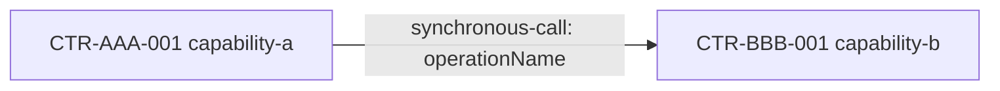

# 契约总览生成模板

本模板定义 `functional/contracts/overview.md` 的生成结果结构。总览只用于导航和理解，不是代码契约，也不参与裁决。

````markdown
# 代码契约总览

> 生成文件：禁止手工修改
> 裁决说明：本文件不参与裁决；发生冲突时，以对应的生效代码契约为准
> 来源摘要：<全部生效契约内容的稳定摘要>

## 能力

### <domain>

- [`CTR-AAA-001 capability-a`](<domain>/capability-a.md)：<适用范围摘要>

## 协作

- [`CTR-AAA-002 collaboration-a`](<domain>/collaboration-a-collaboration.md)
  - 参与能力：`CTR-AAA-001`、`CTR-BBB-001`
  - 关系：`CTR-AAA-001 -> CTR-BBB-001`

## 关系图



## 检查结果

- 无法定位的参与契约：<无或契约路径>
- 重复关系声明：<无或关系>
- 孤立能力：<无或契约标识>
- 循环依赖：<无或依赖环；仅提示，不自动判错>
````

生成器必须保持稳定排序；相同契约输入必须产生相同正文。来源摘要用于判断总览是否过期，不使用生成时间制造无意义差异。
