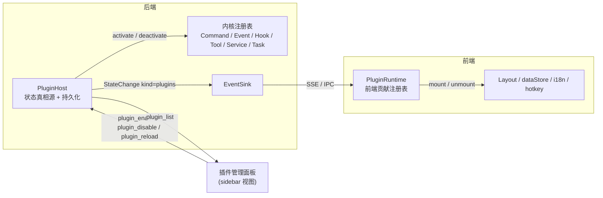

# Spec: Pulsar 插件系统（可拔插管理 · 前后端）

> 状态：**探索 / 设计阶段**，概念层方案，不含落地细节。任务深度 `deep`。
> 关联：[后端架构重构 spec](./2026-09-06_13-55_pulsar-backend-architecture-redesign.md)（固定核心 + 扩展点）、[Hook 三阶段分离 spec](./2026-09-12_10-42_hook-definition-registration-enablement.md)、[architecture.md](../pulsar/architecture.md)。

## Goal

- 要解决什么问题：Pulsar 的能力（工具 / hook / 供应商 / 面板 / 命令 / 事件 …）目前以「写死在组合根与静态注册表」的方式装配，新增能力要改多处，运行时也无法整体开关或替换。需要一套**统一的插件规范**，让能力以「插件」为单元被发现、装载、激活、停用，前后端一体。
- 验收结果（设计阶段）：本 spec 给出插件的定义、边界、生命周期、贡献点清单、前后端协同模型、现有代码到插件的映射与内核需开放的接缝，用户确认后进入方案细化与分期落地。

## Done Contract

- 什么算完成：设计方案获用户确认（本 spec `Execution Approval: Approved`），Open Questions 全部有裁决。
- 由什么证明：用户对本文档的明确批准；后续每一期落地各有独立 spec 引用本文档。
- 哪些情况仍算未完成：仍有会改变实现方向的 Open Question 未裁决；与 🔒 盖章章节冲突未解决。

## Scope

- In：
  - 插件的概念定义、清单（manifest）、生命周期与运行时可拔插语义；
  - 后端 / 前端贡献点（contribution points）清单与各贡献点的拔插规则；
  - 前后端协同模型（谁是真相源、如何同步）；
  - 插件管理面（宿主、管理命令、持久化、管理面板）的职责划分；
  - 现有代码按插件规范重新梳理的**映射表**与**内核需开放的接缝**；
  - 与既有盖章约束的冲突检查；
  - 高层分期建议。
- Out：
  - 具体文件路径 / 函数签名 / 数据格式的最终落地细节（下一阶段各期 spec 负责）；
  - 插件市场 / 分发 / 签名；
  - 第三方原生动态库（`.dll` / `.so`）插件（明确不做，见 §五）。

## Facts / Constraints

- 已确认事实：
  - 后端已按「封闭核心 + 受控扩展点」分层（`core/` / `application/` / `providers/` / `tools/` / `stores/` / `policies/` / `sinks/` / `infra/` + `fileops/` / `terminal/`），扩展点契约：`RoundDriver` / `Hook` / `ModelPort` / `Tool` + `CapabilityExecutor` / `ConversationStore` / `EventSink` / Entry Adapter。
  - `HookRegistry` 已具备「定义 → 注册（默认关）→ 开启（运行时可切）」三阶段与周期门控，是本仓库**最接近插件语义**的现成范式。
  - `ToolRegistry` 有 `register / register_core / register_system`，配置工具与 MCP 已有「保存即全量重装配、装配期 `assemble_lock` 串行化」的重装模型。
  - 命令分发是**封闭的**：`lib.rs` 103 个 Tauri command + `net/rpc.rs` 约 100 个 `match` 分支，一一手写。
  - 状态事件 `StateChange` 是**封闭枚举**（12 个 kind），前端 `dataStore` 以 if-else 链按 kind 重拉。
  - 前端 `viewRegistry` / `mainViews` / `activityItems` / `contracts.ts` / i18n 均为**静态对象**，编译期固定。
  - `runtime/script_engine.rs`（mlua Lua VM）已声明未接入，可作为脚本插件运行时候选。
  - 组合根 `Gateway` 直接持有全部领域句柄（约 15 个字段），`server_runtime::build_server_runtime` 是 GUI 与 headless 共用装配入口。
- 技术 / 业务约束：
  - **不改变固定核心的运行语义**（轮次协议、会话不变量、能力执行协议、事件事实性、并发边界）——插件系统是扩展点之上的**打包 / 生命周期 / 管理层**，不是第二套扩展机制。
  - **🔒 盖章章节不可动**：`docs/pulsar/tool/registration.md` §1–§7（登记单元 / 三来源门禁 / 标签 / 配置声明 / MCP / 手册 / 失败约定）、`conversation/index.md` §4 §5、`terminal/index.md` §1–§7、`fileops/index.md` §1–§8、`topic/index.md` §1–§6、`provider/index.md` §1 §2。冲突检查见 §八。
  - 对外 wire 兼容面（命令名 / 事件名 / `.pulsar/` 布局）在本设计中视为**可演进但需兼容适配**。
- 已知风险：
  - 「运行时卸载」与「进行中的轮次」并存的一致性问题（见 §四 静默规则）。
  - 打开命令 / 事件封闭枚举会触及 Tauri 命令注册（编译期）与前端类型收窄，兼容成本需评估。
  - 插件化后跨域依赖（git / search / terminal 都依赖 workspace）必须显式化，否则激活顺序失控。

## Restated Understanding

- 我理解当前任务是：为 Pulsar 设计一套**前后端一体、运行时可拔插**的插件系统，并用它**反过来梳理现有代码**，使现有能力也成为符合同一规范的插件。
- 当前核心目标是：**定清楚「插件是什么、能贡献什么、怎么被拔插、现有代码怎么归位」四件事**，形成可供用户拍板的设计，而非落地。
- 当前边界是：概念与契约层；不写代码、不定最终文件结构。
- 暂不处理：分发 / 市场 / 签名、第三方原生库、WASM 运行时选型。

---

## 一、核心立场

1. **插件 = 扩展点之上的打包单元，而不是新的扩展点。**
   后端架构重构已经把「什么可以变」定义为受控扩展点。插件系统只回答：这些扩展实现**如何被打包、发现、装载、激活、停用、卸载、管理**。固定核心继续对运行语义封闭。
2. **一个插件 = 一份自述清单 + 一组贡献。** 贡献只能落在核心已开放的贡献点上；插件不能自定义新的注入位置或绕过端口。
3. **拔插分两层：装载级与激活级。**
   - **激活级拔插**：插件已在进程内（内置编译），运行时可 `enable / disable`，贡献随之挂载 / 撤回。所有插件都必须支持。
   - **装载级拔插**：插件包在运行时被读取 / 释放（声明式、脚本、外部进程）。只对非编译进宿主的插件类型成立。
   现有代码迁移的第一目标是**激活级**；装载级面向未来插件类型。
4. **后端是插件启停状态的唯一真相源**；前端插件运行时是事件消费者，随后端状态同步激活 / 停用自己的 UI 贡献。
5. **内核（kernel）与内置插件（built-in plugin）分离**：内核 = 不可停用的运行骨架；其余全部按插件打包，并按 `essential` 标记区分「可停用」与「不可停用但仍走插件规范」。

## 二、术语

| 术语 | 含义 |
|---|---|
| **Kernel（内核）** | 轮次服务、会话协调、各注册表（Hook / Tool / Command / Event / View）、端口契约、组合根、插件宿主本身。不可拔插。 |
| **Plugin（插件）** | 有 `id` / `version` / 清单的能力单元，向若干贡献点提交贡献；有生命周期。 |
| **Contribution Point（贡献点）** | 内核开放的可被插件填充的位置（如 `tools` / `hooks` / `views`）。每个贡献点由一个内核注册表承载。 |
| **Contribution（贡献）** | 插件提交到某贡献点的一条记录（一个工具、一个 hook、一个视图…）。 |
| **Manifest（清单）** | 插件自述：身份、依赖、贡献声明、权限声明、激活策略。 |
| **Plugin Host（宿主）** | 后端插件生命周期管理者：发现 / 装载 / 激活 / 停用 / 卸载 / 持久化启停状态 / 发布 `plugins` 事件。 |
| **Plugin Runtime（前端运行时）** | 前端侧对应物：维护前端贡献注册表、订阅后端 `plugins` 事件、同步激活 / 停用前端贡献。 |
| **Disposable（可撤回句柄）** | 每次激活返回的撤回句柄集合；停用 = 全部撤回。是运行时拔插的技术基石。 |
| **Service（共享服务）** | 插件对其他插件公开的能力（如 `WorkspaceService`）；经内核 `ServiceRegistry` 按接口名取用，不直接 import 对方内部类型。 |

## 三、插件清单（Manifest，概念形状）

```jsonc
{
  "id": "pulsar.git",               // 稳定唯一 id，反向域名风格；内置插件以 pulsar.* 保留
  "version": "1.0.0",
  "displayName": "plugins.git.name", // i18n key
  "description": "plugins.git.desc",
  "kind": "builtin | declarative | script | external",   // 装载技术（见 §五）
  "essential": false,               // true = 不可停用（仍走插件规范），如对话 UI
  "defaultEnabled": true,
  "requires": {
    "kernel": ">=1.0",               // 内核 API 版本
    "plugins": ["pulsar.fileops"]    // 依赖插件，决定激活顺序与停用联动
  },
  "permissions": ["workspace.fs", "shell", "network", "model.call"],  // 声明式权限（对 script / external 生效）
  "contributes": {
    "backend": { "tools": [...], "hooks": [...], "commands": [...], "events": [...], "providers": [...], "tasks": [...], "storage": {...}, "config": {...} },
    "frontend": { "views": [...], "mainViews": [...], "activity": [...], "contracts": [...], "stateHandlers": [...], "i18n": [...], "hotkeys": [...], "settings": [...] }
  }
}
```

要点：

- `id` 是**跨前后端**的同一身份：前端贡献与后端贡献靠同一 `id` 绑定启停。
- `contributes` 中的每一项对应 §四的一个贡献点；未列出的贡献点即不贡献。
- 内置插件的清单可以是 Rust / TS 常量而非 JSON 文件，但**形状一致**。
- `permissions` 对内置插件只做文档作用；对脚本 / 外部插件由宿主强制。

## 四、贡献点清单与拔插规则

### 4.1 后端贡献点

| 贡献点 | 承载注册表（现状 → 需要） | 激活 | 停用 | 备注 |
|---|---|---|---|---|
| `tools` | `ToolRegistry`（有 register，缺 withdraw）→ 增加按 owner 撤回 | 登记工具（**仍受 registration.md 门禁**：native 须带手册；来源仍是 native / config / mcp） | 撤回该插件全部工具 | 插件是「owner」维度，与「来源」维度正交，不新增第四来源（见 §八） |
| `hooks` | `HookRegistry`（有 register / set_enabled，缺 unregister）→ 增加撤回 | 注册 `HookDef`（默认关）+ 按持久化状态开启 | 撤回定义（非仅关闭） | 插件级 disable ≠ hook 级 set_enabled：前者是整体撤回，后者是插件内细粒度开关，两级并存 |
| `commands` | `lib.rs` / `rpc.rs` 手写 match → **`CommandRegistry`（新）** | 登记 `cmd → handler` | 撤回；未注册命令返回统一 `unknown_command` | 内核需从封闭 match 改为开放分发；Tauri 侧以一个通用 `invoke` 命令桥接（见 §七） |
| `events` | `StateChange` 封闭枚举 → **开放事件 kind**（内核 kind + 插件命名空间 kind） | 声明本插件会发布的 kind | 不再发布 | 前端 `stateHandlers` 与之配对 |
| `providers` | `ProviderRegistry` / `ModelPort` | 登记协议客户端 / 供应商适配 | 撤回；会话选中的模型不可达 → 领域错误（既有语义） | 首期仅 `openai_compat` 一个内置实现 |
| `tasks` | `spawn_*_runtime` 散落在 Gateway → **`TaskSupervisor`（新）** | 启动后台任务（poller / 神经元回收 / MCP 装配） | 取消任务并等待收敛 | 后台任务必须可取消，是插件可停用的前提 |
| `storage` | 各自开文件 / 表 → 约定插件私有命名空间 | 打开 `.pulsar/plugins/<id>/` 或 `app.db` 中带前缀的表 | 关闭句柄，不删数据 | 停用不等于清数据；卸载 / 清数据是显式动作 |
| `config` | `ConfigStore` 建模节 + `extra` | 声明本插件配置节 | — | 配置节以插件 id 命名空间隔离 |
| `services` | **`ServiceRegistry`（新）** | 发布共享服务接口 | 撤回；依赖方按 `requires` 联动停用 | 解决 git / search / terminal → workspace 的跨域依赖 |
| `inserts` | `InsertCatalog`（rust-embed） | 提交手册 / 契约文档 | 撤回 | 与 `tools` 门禁配合 |

**不开放为插件贡献点（v1）**：`RoundDriver`、`ConversationStore`、`EventSink`。理由：三者替换即替换运行骨架，属于组合根装配选择而非运行时拔插对象。保留在内核，后续按需评估。

### 4.2 前端贡献点

| 贡献点 | 承载（现状 → 需要） | 激活 | 停用 |
|---|---|---|---|
| `views` | `viewRegistry` 静态对象 → **可变视图注册表 + 容器归位声明** | 注册视图 + 默认容器（sidebar / info / panel） | 撤回；`LayoutStore` 从容器移除、关闭相关 tab |
| `mainViews` | `mainViews` 数组 + `MainPanelType` 联合类型 → 开放类型 | 注册主区面板类型 | 撤回并关闭已开实例 |
| `activity` | `activityItems` | 注册 ActivityBar 入口 | 撤回 |
| `contracts` | `contracts.ts` 单一常量 → 内核契约 + 插件契约分文件 | 提供本插件的命令契约（类型层） | — （类型层无运行时撤回） |
| `stateHandlers` | `dataStore` if-else 链 → **按 kind 的处理器注册表** | 为本插件事件 kind 注册重拉 / 合并逻辑 | 撤回 |
| `i18n` | `zh` / `en` 单文件 → 内核词表 + 插件词表合并 | 合并词表 | 卸载词表（或保留以免闪烁） |
| `hotkeys` | `hotkey/` 服务 | 注册快捷键 | 撤回 |
| `settings` | （新）插件设置页 | 注册设置面板 / 表单 schema | 撤回 |
| `messageBlocks`（后续） | 消息区内联卡（`ui-message-cards.mdc`） | 注册自定义消息渲染块 | 撤回 |

### 4.3 运行时拔插的静默规则（一致性）

- **快照隔离**：轮次开始时对 Hook / Tool 目录取快照（`HookRegistry::snapshot` 已如此；工具授权亦在轮次内一次读取）。进行中的轮次以快照完成；停用只影响**后续轮次**。
- **不打断进行中的轮次**：停用插件不取消活动轮次；若插件的工具在快照中而执行时已撤回，按既有「未知工具 → 结果配对为错误」语义收敛，不静默丢弃。
- **后台任务先停**：停用顺序 = 取消 `tasks` → 撤回 `hooks` / `tools` / `commands` → 撤回 `services` → 关闭 `storage` → 发布 `plugins` 事件。
- **依赖联动**：停用被依赖插件时，依赖方级联停用（先停依赖方）；激活时先激活依赖。
- **前端跟随**：前端收到 `plugins` 事件后再撤回 UI 贡献，不自行决定启停。

## 五、插件类型（按装载技术）

| kind | 载体 | 装载级拔插 | 激活级拔插 | 权限模型 | 阶段 |
|---|---|---|---|---|---|
| `builtin` | 编译进宿主的 Rust 模块 + 静态 import 的 Svelte 模块（可 code-split 懒加载） | 否 | 是 | 信任（与内核同权） | **v1 主体**：现有代码迁移目标 |
| `declarative` | 清单 + 声明式贡献（HTTP 工具 / 命令模板 / MCP server / prompt 手册） | 是 | 是 | 由声明类型决定（沿用护栏） | v2：现有 `dynamic_tools.json` / `mcp_servers.json` 升格为插件包 |
| `script` | Lua（mlua，已 vendored）脚本实现 `tools` / `hooks`（IP-3 / IP-4 等只读或改写型） | 是 | 是 | 沙箱 + 声明式权限 | v3 |
| `external` | 独立进程（stdio / http），协议化贡献（MCP 已是此形态的工具子集） | 是 | 是 | 进程隔离 + 权限 | v3+ |
| ~~`native-dylib`~~ | `.dll` / `.so` | — | — | 无 ABI 稳定性、无隔离 | **不做**；如需二进制级扩展未来评估 WASM |

前端侧 `builtin` 之外的「远程 ESM 模块加载」（v4）需处理 Tauri CSP 与安全模型，v1–v3 不涉及。

## 六、生命周期与状态机

```text
Discovered ──load──▶ Loaded ──activate──▶ Active
    ▲                  │  ▲                 │
    │                  │  └───deactivate────┘
    └─────unload───────┘
                    (任何阶段失败 → Failed{reason}，可 retry / disable)
```

- **Discovered**：宿主知道该插件存在（内置清单列表 / 扫描 `.pulsar/plugins/`）。
- **Loaded**：清单校验通过（id 唯一、依赖可满足、内核版本匹配、权限可授予），贡献声明已解析，**尚未挂载任何贡献**。
- **Active**：贡献已挂载到各注册表，后台任务已启动；返回 `Disposable` 集合。
- **Failed**：保留清单与错误原因供管理面展示；不影响其他插件。
- 持久化：`.pulsar/plugins.json` 记录 `enabled` 集合与插件级设置；启动时按「依赖拓扑序」激活 `enabled ∩ defaultEnabled` 集合。`essential` 插件忽略 disable 请求并返回可读错误。

## 七、前后端协同模型



- 管理命令（概念）：`plugin_list` / `plugin_enable` / `plugin_disable` / `plugin_reload` / `plugin_get_settings` / `plugin_set_settings`。
- 事件：`kind = "plugins"`，载荷含变更的插件 id 与新状态；前端 `PluginRuntime` 据此挂载 / 撤回该 id 的前端贡献，`dataStore` 内核部分无需感知具体插件。
- **命令分发开放化**：后端 `CommandRegistry` 成为 Tauri / RPC / TUI / CLI 共同的分发面；Tauri 侧保留一个通用桥接命令（参数 `{cmd, params}`，与 RPC 载荷同构）承载插件命令，内核既有命令可分期迁入。前端 `api.call(contract)` 契约面不变。
- 前端插件可以**无后端贡献**（纯 UI），后端插件也可以**无前端贡献**（纯能力）；都由同一 `id` 治理。

## 八、与既有盖章约束的冲突检查

| 盖章章节 | 插件设计是否触碰 | 结论 |
|---|---|---|
| `tool/registration.md` §2 三来源门禁 | 插件提供的工具若视为「第四来源」则冲突 | **不新增来源**：插件是「owner」正交维度；插件内 native 工具照旧带手册、config 工具照旧声明即 schema、MCP 照旧远端自述。无冲突。 |
| `tool/registration.md` §1 同名唯一 / §7 失败约定 | 撤回是新增操作 | 撤回不改变登记规则；停用后再激活的重复登记由「先撤回再登记」保证不触发同名冲突。无冲突。 |
| `tool/registration.md` §4 §5 重装配模型 | 声明式插件升格自 `dynamic_tools.json` / `mcp_servers.json` | 保留「保存即全量重装配 + 装配串行化」语义；插件宿主复用同一串行闸。无冲突，但 v2 落地时需再核对。 |
| `conversation/index.md` §4 §5 | 快照隔离 / 不打断轮次 | 顺应「同一会话同一时刻一轮、上下文安全」约定。无冲突。 |
| `terminal` / `fileops` / `topic` / `provider` 各盖章节 | 仅打包为插件，不改语义 | 无冲突；迁移时逐节对照。 |

若后续用户希望「插件提供的工具」在管理面上单列为独立来源，需**先解章** `registration.md` §2。

## 九、现有代码 → 插件映射（概念归位）

> 目的：验证规范能覆盖现状；最终颗粒度待用户拍板（见 Open Questions）。

| 归位 | 后端 | 前端 | `essential` | 备注 |
|---|---|---|---|---|
| **Kernel** | `core/*`（轮次服务 / 协调 / 契约 / 端口 / HookRegistry / 默认策略）、`ToolRegistry` + `CapabilityAdapter`、`ProviderRegistry` 机制、`JsonConversationStore`、`StateEventSink`、`Gateway`（收缩为组合根 + PluginHost）、`server_runtime`、`net/*`、`infra/*`、`drivers.rs` 四驱动、`chat_session` / `agent_session` | `layout/*`、`api/*`、`dataStore` 内核部分、`i18n` 内核词表、`hotkey` 服务、`PluginRuntime` | — | 不可拔插 |
| `pulsar.conversation-ui` | — | `ChatArea` / `ChatMessage` / `SessionList` / `ThinkingBlock` / `ToolCallBlock` / `ToolResultBlock` / `StatusBar` | **true** | 走插件规范但不可停用 |
| `pulsar.providers` | `openai_compat` 协议客户端（provider 贡献） | `ProvidersModelsPanel` / `ProviderManager` | true | 供应商治理 UI |
| `pulsar.assistant` | `assistant_session` / `AssistantHooks` 4 条 hook / `hook/instances` 裁决 / `HookJudgementStore` / `insert_catalog` 中裁决契约 / `poller` + `poller_step` / `session_tracker`（待议）/ `topic_store` + `topic_manager` | `TopicPanel` / `PollerPanel` / `HookJudgementPanel` / `JudgementCard` / `NudgeBlock` | false | 最大的一块；Topic 是否独立成 `pulsar.topic` 待议 |
| `pulsar.neuron` | `policies/neuron/*`、神经元回收任务、`round_resolver` 对 `NeuronManager` 的直连（需改为内核 `RoleSelector` 端口 + 默认实现） | `NeuronManager` / `NeuronListPanel` / `NeuronDetailDrawer` / `features/neuron` | false | 顺带清除架构重构登记的「待拆例外」 |
| `pulsar.compaction` | `Compactor` + IP-2 hook `core.compaction` | — | false | 纯后端插件样例 |
| `pulsar.fileops` | `fileops/workspace` / `fs` / `fs_tools`（11 工具）；发布 `WorkspaceService` | `FileExplorer` / `FileEditor` / `fileEditorStore` / 路径补全 | true | 被 git / search / terminal 依赖 |
| `pulsar.git` | `fileops/gitops/*`（15 工具 + 确认服务 + 危险开关配置节） | `GitPanel` / `GitDiff` / `CommitDiff` / `GitConfirmHost` | false | `requires: pulsar.fileops` |
| `pulsar.search` | `fileops/search/*`（索引 + 检索 + `semantic_search` 工具） | `SearchPanel` | false | `requires: pulsar.fileops` |
| `pulsar.terminal` | `terminal/*`、`execute_command` 工具 + `AgentTerminalBridge`、WS topic `terminal` | `TerminalPanel` / `terminal/transport` | false | 停用后 `execute_command` 缺席（Core 组少一员，需确认可接受） |
| `pulsar.mcp` | `tools/mcp.rs` + `mcp_servers.json` + 状态 | `ToolPanel` 中 MCP 段 | false | v2 升格为 declarative 宿主 |
| `pulsar.dynamic-tools` | `tool_config` + `dynamic_tool` | `ToolEditor` / `ToolPanel` 中配置工具段 | false | 同上 |
| `pulsar.logs` | `sinks/app_log` + 日志命令 | `LogPanel` | false | 日志文件落盘留内核，面板与查询命令入插件 |
| `pulsar.current-time` | `get_current_time` 工具 | — | false | **参考样例插件**（最小完整示例） |

映射直接暴露的内核接缝（v1 必须开放）：

1. `CommandRegistry` 取代 `lib.rs` / `rpc.rs` 手写分发；
2. `StateChange` 从封闭枚举改为「内核 kind + 命名空间 kind」；
3. `ToolRegistry` / `HookRegistry` 增加按 owner 撤回；
4. `TaskSupervisor` 收编散落的 `spawn_*_runtime`；
5. `ServiceRegistry` 承载跨插件服务（首个：`WorkspaceService`）；
6. `round_resolver` → `NeuronManager` 直连改端口；
7. 前端 `viewRegistry` / `mainViews` / `dataStore` handlers / i18n 由静态对象改为可变注册表；
8. `Gateway` 收缩：领域句柄转由各插件持有，Gateway 只保留内核组合与 PluginHost。

## 接口契约设计（伪代码，概念层）

```rust
// ── 后端：宿主与生命周期 ──
trait Plugin: Send + Sync {
    fn manifest(&self) -> &PluginManifest;
    /// 把贡献挂到各注册表；返回撤回句柄集合。不得在此直接触碰核心运行语义。
    async fn activate(&self, ctx: &ActivationContext) -> Result<Disposables, PluginError>;
    /// 可选：停用前的收尾（默认空实现，撤回由 Disposables 统一完成）。
    async fn on_deactivate(&self) -> Result<(), PluginError> { Ok(()) }
}

struct ActivationContext {   // 宿主提供给插件的受控能力面
    tools: ToolContributor,        // register(owner=id, tool)  → Disposable
    hooks: HookContributor,        // register(owner=id, def)   → Disposable
    commands: CommandContributor,  // register(owner=id, cmd, handler) → Disposable
    events: EventPublisher,        // publish(kind = "<id>:<name>", payload)
    tasks: TaskSupervisorHandle,   // spawn(cancel_token)       → Disposable
    services: ServiceRegistryHandle, // provide<T>() / require<T>()
    storage: PluginStorage,        // 命名空间受限的存储句柄
    config: PluginConfigSection,   // 命名空间受限的配置节
}

struct PluginHost { /* discover / load / activate / deactivate / unload / list / persist */ }
impl PluginHost {
    fn register_builtin(&mut self, plugin: Box<dyn Plugin>);      // 内置插件在组合根登记
    async fn activate(&self, id: &PluginId) -> Result<(), PluginError>;   // 含依赖拓扑
    async fn deactivate(&self, id: &PluginId) -> Result<(), PluginError>; // 含级联
    fn snapshot(&self) -> Vec<PluginEntry>;  // 管理面数据源
}
```

```ts
// ── 前端：运行时与贡献 ──
interface FrontendPlugin {
  readonly id: string;                                // 与后端 manifest.id 一致
  activate(ctx: FrontendActivationContext): Disposable[];
}
interface FrontendActivationContext {
  views: ViewContributor;            // register(reg, defaultContainer) → Disposable
  mainViews: MainViewContributor;
  activity: ActivityContributor;
  stateHandlers: StateHandlerContributor; // on(kind, handler) → Disposable
  i18n: I18nContributor;             // merge(bundle) → Disposable
  hotkeys: HotkeyContributor;
  api: ApiClient;                    // 复用 api.call(contract)
}
class PluginRuntime {
  registerBuiltin(plugin: FrontendPlugin): void;
  /** 订阅后端 kind=plugins 事件；按 id 同步激活 / 停用前端贡献。*/
  bind(api: ApiClient): void;
}
```

## 十、高层分期建议（非承诺，待拍板）

| 期 | 目标 | 拔插层级 |
|---|---|---|
| **P0 内核开放** | 落地 §九 列出的 8 处接缝；`PluginHost` / `PluginRuntime` 骨架；`pulsar.current-time` 作为样例插件跑通全链路（激活 / 停用 / 面板可见） | 激活级 |
| **P1 内置插件迁移** | 现有域按 §九 映射逐个打包为 `builtin` 插件；插件管理面板；`essential` 与 `requires` 生效 | 激活级 |
| **P2 声明式插件** | `.pulsar/plugins/<id>/plugin.json`；`dynamic_tools` / `mcp_servers` 升格为声明式插件包；扫描与热装载 | 装载级 |
| **P3 脚本 / 外部插件** | mlua 沙箱插件（工具 + 只读 / 改写型 hook）；外部进程协议化 | 装载级 + 权限 |
| **P4 前端远程模块** | 远程 ESM 加载 + CSP 方案 | 装载级（前端） |

每期各立 spec，引用本文档为设计基准。

## Open Questions

- [ ] **Q1 颗粒度**：§九映射中 `pulsar.assistant` 是否拆为 `assistant` / `topic` / `poller` 三个插件？`session_tracker` 归内核还是 assistant？
- [ ] **Q2 essential 集合**：`conversation-ui` / `providers` / `fileops` 三个标记为不可停用是否认可？`terminal` 停用会让 Core 组缺 `execute_command`，是否接受？
- [ ] **Q3 v1 拔插层级**：是否认可「v1 只做激活级（内置插件运行时启停），装载级留给声明式 / 脚本插件」？
- [ ] **Q4 命令分发开放化**：是否认可用 `CommandRegistry` + 通用 Tauri 桥接命令替代手写 match（对外命令名保持兼容）？
- [ ] **Q5 事件 kind 开放化**：是否认可 `StateChange` 从封闭枚举改为「内核 kind + `<pluginId>:<name>` 命名空间 kind」？
- [ ] **Q6 Driver / Store / Sink 不进 v1 贡献点**：是否认可？
- [ ] **Q7 数据保留**：停用不删数据、卸载 / 清数据为显式动作，是否认可？
- [ ] **Q8 命名**：统一用「插件（plugin）」还是「扩展（extension）」？（影响命令名 / 目录名 / 面板标题）
- [ ] **Q9 脚本运行时**：v3 沿用已 vendored 的 mlua（Lua）还是评估 WASM？（v3 前不需拍板，仅登记）

## Goal Alignment Check

- 当前动作是否仍服务于核心目标：是——本轮产出即「插件是什么 / 能贡献什么 / 怎么拔插 / 现有代码怎么归位」四件事的设计。
- 若否，偏差在哪里：无。
- 是否需要调整本轮目标或范围：不需要；Open Questions 裁决后进入 P0 spec。

## Checkpoint Summary

- 当前任务理解：为 Pulsar 设计前后端一体、运行时可拔插的插件系统，并用它梳理现有代码。
- 当前核心目标：形成可拍板的概念层设计。
- 当前进度：设计初稿完成（本文档）。
- 下一步 1：用户裁决 Open Questions Q1–Q8。
- 下一步 2：按裁决修订本 spec → 起草 P0（内核开放 + 样例插件）spec。
- 涉及文件 / 模块：本文档；后续 P0 涉及 `core/` 注册表、`application/gateway.rs`、`net/rpc.rs`、`lib.rs`、前端 `layout/` / `api/` / `stores/`。
- 风险：命令 / 事件开放化的兼容成本；停用与活动轮次的一致性（已由 §4.3 静默规则约束）。
- 验证方式（设计阶段）：用户评审确认；与盖章章节的冲突检查（§八）。
- Execution Approval: `Pending`

## Change Log

- 2026-09-20：初稿。核心立场（插件 = 扩展点之上的打包单元）、术语、清单形状、前后端贡献点与拔插规则、静默规则、插件类型、生命周期、协同模型、盖章冲突检查、现有代码映射与 8 处内核接缝、伪代码契约、分期建议、Open Questions ×9。

## Validation

- Self-check：已对照 `architecture.md`、后端架构重构 spec、`HookRegistry` 实现、`viewRegistry` / `contracts.ts` / `dataStore` 现状、`registration.md` 盖章章节。
- Static checks：不适用（无代码）。
- Runtime / Test：不适用。
- Human confirmation：待用户评审。
- 结果汇总：设计初稿待评审。
- 核心目标是否已由证据证明完成：否（等待用户裁决）。
- 若未完成，当前剩余差距：Open Questions 裁决。
- 剩余风险：见 Facts / Constraints「已知风险」。

## Resume / Handoff

- 当前状态：设计初稿已落盘，等待评审。
- 当前卡点：Open Questions Q1–Q8 需用户拍板。
- 下一步唯一动作：按用户裁决修订本 spec，然后起草 P0 spec。
- 下一轮核心目标：P0 内核开放 + 样例插件 `pulsar.current-time` 全链路设计。
